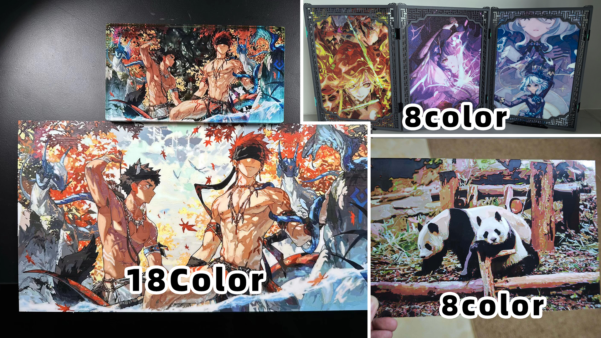
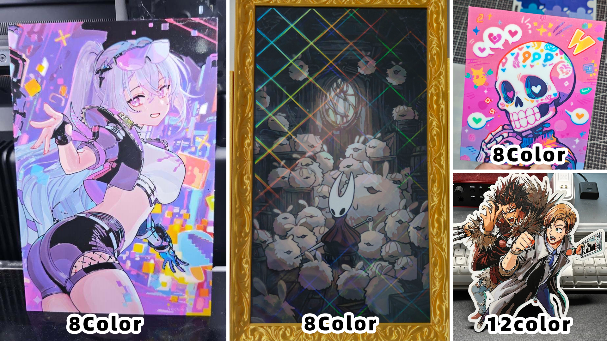
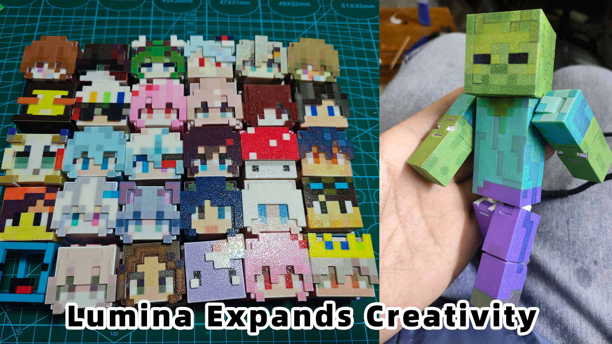
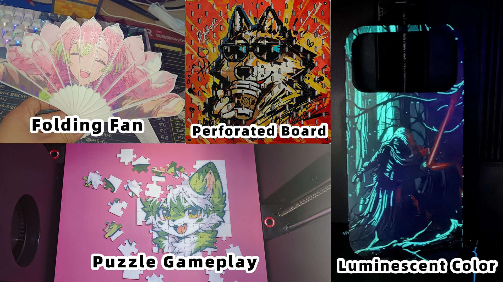
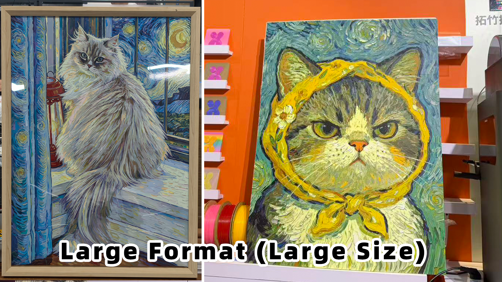
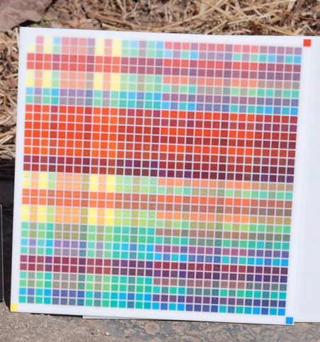
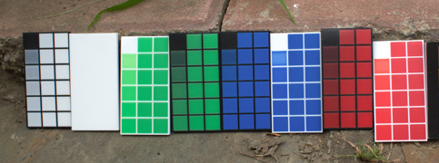

<p align="center">
  
</p>

<h1 align="center">Lumina Studio 2.0</h1>

<p align="center">
  Flat full-colour FDM printing
</p>

<p align="center">
  Layer filaments to reproduce the colours and tonal detail of an image.
</p>

<p align="center">
  <a href="README_CN.md">简体中文</a>
  ·
  <a href="#installation">Run from source</a>
  ·
  <a href="https://wiki.luminastudio.com.cn/">Project Wiki</a>
  ·
  <a href="#what-is-in-20">Features</a>
</p>

<p align="center">
  <a href="https://www.patreon.com/c/lumina_studio">
    
  </a>
  &nbsp;&nbsp;
  <a href="https://www.ifdian.net/a/MMMINNN">
    
  </a>
</p>

<p align="center">
  <a href="https://www.luminastudio.com.cn/sponsors"></a>
</p>

<p align="center">
  <a href="https://www.luminastudio.com.cn/"></a>
  <a href="https://wiki.luminastudio.com.cn/"></a>
  <a href="https://b23.tv/CCxxiKC"></a>
  <a href="https://www.youtube.com/channel/UCyP2Euw9whk1j-MT8d652Kw"></a>
  <a href="https://qm.qq.com/q/vocxOMTnj2"></a>
  <a href="https://discord.gg/57whRe3C8G"></a>
</p>

<p align="center">
  <a href="https://x.com/wLuF53gzlV98666"></a>
  <a href="https://www.tiktok.com/@dy6kueohw5ii"></a>
  <a href="https://bsky.app/profile/wluf53gzlv98666.bsky.social"></a>
  <a href="https://mastodon.social/@wluf53gzlv98666"></a>
</p>

## Bring the print closer to the original

Lumina Studio 2.0 layers different filaments to reproduce an image's colours and shading in a flat full-colour FDM print.

It uses calibration data from your materials to match layer recipes to the image. Compare the preview with the original, change colours you do not like, and adjust gradients or recipes in individual regions. Then export a 3MF for your slicer.

Use an existing LUT preset, or photograph gradient cards to build your own material profiles. Combine your materials and adjust colour layers and layer height.

## Printed by users

<p align="center">
  
</p>

<p align="center">
  
</p>

<p align="center"><sub>Colour, shading, and detail with different filament combinations.</sub></p>

## What you can make

Start with a photo, illustration, or piece of pixel art. Make framed pictures, standing cut-outs, keychains, or fridge magnets, or add your own structural design and try something different.

<p align="center">
  
</p>

<p align="center"><sub>With structural design and assembly, pixel characters can become jointed figures.</sub></p>

<p align="center">
  
</p>

<p align="center"><sub>A folding fan, perforated board, playable puzzle, and luminescent colour.</sub></p>

<p align="center">
  
</p>

<p align="center"><sub>If the whole picture will not fit on the bed, print it in sections and assemble or frame it.</sub></p>

These are physical prints made by Lumina users; colour counts follow the makers' labels. The photos are shown with permission for the project. Copyright in the depicted artwork remains with its respective creator. See the [image record](assets/readme/SOURCES.md).

## What is in 2.0

| What you want to do | How to do it in Lumina |
| --- | --- |
| Reproduce colours and image detail | Choose high-fidelity, pixel, or SVG vector mode to suit the image. Crop, handle transparency, or vectorise a bitmap, then compare the colour result with the original and inspect it in 3D. |
| Fix a colour you do not like | Select colours or a local region, replace colours, change recipes, and adjust gradients. Undo a change, or save a JSON project or PNG share card and carry on another day. |
| Use your own filaments | Print and photograph gradient cards, then organise profiles and palettes in the material library. Fixed colour boards and existing LUT presets are still there. |
| Reuse your conversion settings | Save the source type, filament combination, size, structure, layers, and coating settings as a preset for next time. Images and local edits belong in a JSON project or PNG share card. |
| Make a keychain, fridge magnet, or similar piece | Add loops, magnet cavities, outlines, or transparent coating; choose single-sided, double-sided, relief, or cloisonné construction. Which options work together depends on the mode. |
| Put artwork on an existing model | Open model-surface mode, select a planar face, and adjust the image's position, size, and angle before generating. |
| Make a puzzle or a larger print | Use puzzle, large-format tiling, or batch conversion, arrange work for the selected printer bed, and export the projects. |
| Try other creative tools | Install independent modules through Creative Workshop. The official bead-pattern studio can send its result back to Lumina for colour matching and printing. Community modules need the Electron desktop app; trusted official modules also work in the browser. |

The interface has Chinese and English, plus light and dark themes. Use the preview while editing, then check materials, process settings, and placement in your slicer before printing.

## Your first print

1. **Prepare material profiles.** Import profiles that match the filaments you will use, or print and photograph gradient cards, then extract and save profiles in Material Extraction.
2. **Choose your filament combination.** Set Source Type to Material Archive, select the filaments for this print, and set the number of colour layers and layer height.
3. **Import an image or SVG.** Set its physical size and modelling mode, then create a preview.
4. **Edit the result.** Compare it with the original and adjust local colours, recipes, and structure. To add a transparent coating, enable it and set its thickness. Save a JSON project or PNG share card to continue later.
5. **Select a printer and generate.** Choose the slicer, device, nozzle, and build plate in Settings, then download the 3MF or multi-plate ZIP.
6. **Check it in the slicer.** Confirm filament slots, temperatures, layer height, wipe tower, and bed limits before slicing and printing.

For a first try, use a few profiled filaments to print a small sample and check how closely the colours and shading match the image. Recombine existing profiles when you want a different palette; when you add a new filament, create a profile for it.

## Why calibration matters

Two rolls labelled red can look quite different when layered. Layer height, stacking order, material batch, print settings, and lighting all matter too. That is why Lumina records the colours of a physical print first and uses those measurements for colour matching.

### Fixed boards and LUTs

<p align="center">
  
</p>

The fixed-board process is straightforward: generate a board, print it, photograph it, extract the colours, and save a LUT. Choose a preset setup for 2, 4, 6, or 8 materials. A new material set or important setting change usually means making a new calibration board.

LUT inputs include `.npy`, keyed `.json`, `.npz`, and `.msgpack`. Match the preset's material order, layer height, and colour mode to the actual print; the filename or colour count alone is not enough.

The [project Wiki](https://wiki.luminastudio.com.cn/) has guidance on photography and colour extraction.

### Gradient cards and material profiles

<p align="center">
  
</p>

Gradient cards record a material's data first, then profiles are combined to calculate colour mixing. Changing a palette does not require a complete fixed board for every combination. Organise, import, and export profiles in the material library, then use them for colour matching.

Photography and calculation both have some error, so check the colour on a real print. A small sample is a good way to check colour and thickness before starting a large piece. More finished work is in the [users' gallery](https://www.bilibili.com/opus/1211359624212512770).

## Source Nightly

Try recent changes from the [source previews](https://github.com/lumina-layer-studio/Lumina-Layers/releases?q=nightly-&expanded=true). A preview is published automatically after a maintainer reviews and merges a PR and all main-branch CI workflows pass for that commit.

Each preview has its own tag, commit SHA, and release notes. Download **Source code (zip)** or **Source code (tar.gz)** from the release page, extract it, and follow the installation steps below. No installer or portable application is provided.

For a downloaded archive, open a terminal in the extracted directory and start at installation step 2. Skip the Git clone step so you keep using the selected preview commit.

Previews may still have bugs. Back up important projects and include the release's commit SHA when reporting a problem. Failed checks do not publish a new preview; the previous one remains available.

## Installation

Run the source in a browser or in the Electron desktop window.

### Requirements

| Dependency | Version |
| --- | --- |
| Python | Standard 64-bit CPython; **3.12 recommended**, 3.12–3.14 supported. |
| Node.js | **24.x recommended**; 22.x must be at least 22.13. |
| pnpm | **10.33.2**, matching the repository's `packageManager`. |

Install [Python](https://www.python.org/downloads/), [Node.js](https://nodejs.org/en/download), and [pnpm](https://pnpm.io/installation). If using Corepack, enable it and select the pnpm version above; do not assume that Node.js includes Corepack.

Precompiled dependencies for the complete application cover:

| System | Architecture and minimum |
| --- | --- |
| Windows | x64 |
| Linux | x86-64, glibc 2.28 or newer |
| macOS | Apple Silicon (arm64), macOS 14 or newer |

Intel Mac, Linux ARM, Alpine/musl, Windows ARM, 32-bit, and free-threaded Python are outside this complete dependency set. This is the intersection of the required dependencies, not a claim of physical printing tests on every platform or device.

### 1. Get the 2.0 source

```bash
git clone https://github.com/lumina-layer-studio/Lumina-Layers.git
cd Lumina-Layers
```

### 2. Create and activate a Python environment

```bash
python -m venv .venv
```

If macOS/Linux provides only `python3`, create it with `python3 -m venv .venv`. Activate it for your shell:

| Shell | Command |
| --- | --- |
| Windows PowerShell | `.\.venv\Scripts\Activate.ps1` |
| macOS / Linux | `source .venv/bin/activate` |

### 3. Install dependencies and start

From the repository root, with the environment active:

```bash
python -m pip install --upgrade pip
python -m pip install --find-links <wheelhouse> -r requirements.txt
pnpm --dir frontend install --frozen-lockfile
python start_all.py
```

Open the frontend address printed by the launcher, normally `http://localhost:4174`. The backend uses port `8000` by default. Follow the launcher's prompt to stop it.

Source installs do not connect to an online material library by default. Local material profiles work offline. To connect a Registry you host or are authorized to use, configure its service URL separately; see the [Registry connection guide](docs/material-registry-connection.md).

The native 3MF dependencies are `fatcat-metadata==0.1.3` and the official `neroued-3mf==0.4.2` release. Both install from PyPI through `requirements.txt`; no custom writer wheelhouse is needed. See [the native dependency guide](docs/desktop-electron.md) for supported platforms. The SVG dependency remains `lumina-svg-core==0.3.4`.

### Optional: desktop window

After installing the Python and frontend dependencies above:

```bash
pnpm --dir electron install --frozen-lockfile
pnpm --dir electron start
```

The desktop window starts its own Python backend and frontend, so do not also run `start_all.py`. Confirming exit stops the processes it started.

## One more look before printing

- Check that the materials and layer height match your profile or preset. Transparent coating follows the model's material type; mixed or unknown types default to PLA. Confirm the actual transparent filament, temperatures, and compatibility warnings in the slicer before printing.
- Model surface overlay currently cannot be exported together with large-format tiling; choose one of the two workflows.
- If a large model's wipe tower or brim will not fit, Lumina keeps the warning and lets you download the project. You still need to arrange it in the slicer; a downloaded file has not necessarily been placed or sliced successfully.
- Prusa export currently uses the **PrusaSlicer 3.0.0-alpha12** preview format. Check compatibility before using another version. Details are in [3MF export](docs/3mf-metadata-export.md).
- Save a JSON project or PNG share card to continue editing later, and keep the original image, presets, and material profiles for important projects.

## Documentation, community, and support

The [project Wiki](https://wiki.luminastudio.com.cn/) contains guides and updates; the [multi-brand slicer guide](https://wiki.luminastudio.com.cn/zh/docs/tutorials/slicer-guide) covers print setup.

Share a print or ask for help through the QQ and Discord links above. For a software problem, the built-in feedback tool helps us reproduce it: include what you did, the version, and relevant files. Reports are saved under local `feedback/` before submission to the official service. To keep them on your device, set `LUMINA_FEEDBACK_SERVER_URL=off` in `.env.local`. See [.env.example](.env.example) and [bug report details](docs/bug-report-reproducibility.md).

Lumina Studio is a non-profit open-source community project. If it has helped you and you would like to keep the work going, you can support it on Afdian or Patreon. Support goes towards development, testing, documentation, packaging, and community maintenance. The [sponsors page](https://www.luminastudio.com.cn/sponsors) lists supporters and material-brand adaptation information.

## License and commercial use

Project-owned 2.0 software is licensed under **AGPL-3.0-only**. Independent modules, dependencies, and resources retain their own terms. See [LICENSE](LICENSE), [LICENSING.md](LICENSING.md), and [third-party resource notices](THIRD_PARTY_NOTICES.md).

Individuals and businesses may use the software free of charge. Generated model files and physical prints may be sold commercially; public sharing or sale requires Lumina-Layers attribution under the [output terms](OUTPUT-TERMS.md). Contact the development team for separate written closed-source integration rights or an output-attribution waiver, as described in [commercial authorization](COMMERCIAL-LICENSE.md).

## Contributing

Contributions of reproducible issues, code, presets, material measurements, translations, and documentation are welcome. The source uses Python + FastAPI, React + TypeScript, and an Electron desktop host. Start with [CONTEXT-MAP.md](CONTEXT-MAP.md). Tests additionally need `requirements-dev.txt`. PostgreSQL is optional; ordinary local use needs no database.

- [Changelog](CHANGELOG.md)
- [Development and testing](docs/test_operations.md)
- [Workshop module development](docs/workshop-module-development.md) and the [public SDK](https://github.com/lumina-layer-studio/Lumina-Workshop-SDK)

Thanks to HueForge, AutoForge, [ChromaStack](https://github.com/borealis-zhe/ChromaStack), [LD_ColorLayering](https://github.com/Luban-Daddy/LD_ColorLayering), [ChromaPrint3D](https://github.com/Neroued/ChromaPrint3D), and the wider 3D-printing community for sharing their work. Third-party code, data, and resources remain subject to their respective licences and attribution notices.

## Contributors

<p align="center">
  <a href="https://github.com/lumina-layer-studio/Lumina-Layers/graphs/contributors">
    
  </a>
</p>

<p align="center">Thank you to everyone who contributed code, test prints, presets, translations, and documentation.</p>
