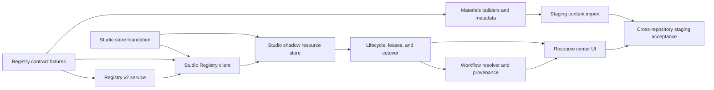

# Cloud Resource Center V2 Master Implementation Plan

> **For agentic workers:** REQUIRED SUB-SKILL: Use superpowers:subagent-driven-development (recommended) or superpowers:executing-plans to implement this plan task-by-task. Steps use checkbox (`- [ ]`) syntax for tracking.

**Goal:** Deliver the approved cloud material and cloud LUT resource-center design across Registry, Materials, and Studio without changing v1 behavior in place or risking existing local content.

**Architecture:** Freeze cross-repository contracts in Registry fixtures first, add Registry v2 as an independently gated read/write projection, then publish compatible Materials metadata before Studio builds a shadow v2 store. Studio cuts material and LUT writers over independently only after recovery, lease, and legacy-adapter tests pass; the shared frontend is enabled last and consumes per-domain capabilities.

**Tech Stack:** Python 3, FastAPI, SQLite and filesystem package storage in Registry, deterministic ZIP/JSON tooling in Materials, FastAPI/Python resource storage in Studio, React 19/TypeScript/Zustand/Tailwind/Vitest, pytest/Hypothesis, Playwright, GitHub pull requests.

---

## Authority And Starting State

The approved design is the normative contract:

- `docs/superpowers/specs/2026-07-10-cloud-resource-center-v2-design.md`
- Design PR: `Lumina-studio#503`
- Design merge commit: `9e474fc73e96032a1b7dc2ed15ec884daf364c35`

Implementation starts from these exact repository revisions:

| Repository | Base branch | Required starting commit |
|---|---|---|
| Lumina Studio | `dev-refactor` | `9e474fc73e96032a1b7dc2ed15ec884daf364c35` |
| Lumina Material Registry | `master` | `ba6e642b4a9565f66363951bcceef095eb8081da` |
| Lumina Materials | `master` | `163103130c531260bc58ba5c913cc856f1808dea` |

Before implementation, register the workstream and its PR train in the online tracking spreadsheet. Use new `codex/feat/...` or `codex/chore/...` branches; never append work to a merged branch and never push directly to a protected branch.

## Plans In This Program

Use these documents as subsystem task scopes; execute their task slices in the dependency order fixed by the PR train below. Studio Store Tasks 1-2 land before Integration Tasks 1-3, then Store Tasks 3-5 consume the merged binder. A later slice may prepare tests while an earlier PR is under review, but no downstream compatibility code may be merged before its upstream contract/type exists.

1. `docs/superpowers/plans/2026-07-13-cloud-resource-center-v2-registry.md`
2. `docs/superpowers/plans/2026-07-13-cloud-resource-center-v2-materials.md`
3. `docs/superpowers/plans/2026-07-13-cloud-resource-center-v2-studio-store.md`
4. `docs/superpowers/plans/2026-07-13-cloud-resource-center-v2-studio-integration.md`
5. `docs/superpowers/plans/2026-07-13-cloud-resource-center-v2-frontend-acceptance.md`

## Design Coverage Map

Every normative design section has an executable owner. A plan PR is incomplete if a design section loses all mapped tasks during review.

| Design sections | Executable coverage |
|---|---|
| 1-4: problem, decisions, goals, information architecture | Master non-negotiable contracts; Frontend Tasks 1-5 |
| 5-6: identity, state, and local lifecycle | Store Tasks 1-7; Integration Tasks 5-9; Frontend Tasks 1, 5, 6 |
| 7: three-repository ownership | Registry Tasks 1-9; Materials Tasks 1-6; Master PR train |
| 8: Registry public contract | Registry Tasks 1, 4-8; Integration Tasks 1-4 |
| 9: Studio API and frontend adapters | Integration Task 5; Frontend Tasks 1-3 |
| 10: publisher, channel, and review semantics | Registry Tasks 3, 6-9; Materials Tasks 3, 5, 6; Frontend Tasks 1, 4, 7 |
| 11: package and path safety | Registry Tasks 1, 2, 4, 6, 8; Materials Tasks 2, 4, 6; Store Tasks 1-7 |
| 12: local index v2 | Store Tasks 1-8 |
| 13: migration | Registry Task 3; Store Tasks 5-7; Master deployment rehearsal |
| 14-15: offline, errors, cache, and consistency | Registry Tasks 6-8; Integration Tasks 2-5; Frontend Tasks 2, 4, 10 |
| 16: observability | Integration Task 12; Master staging gate |
| 17: testing strategy | Every plan task follows red-green-refactor; each repository has a full merge gate |
| 18: performance and capacity | Registry Tasks 4, 7-9; Store Tasks 2, 6, 8; Master load and soak gate |
| 19-20: delivery, deployment, and rollback | Master PR train and deployment tasks; Registry Task 9; Frontend Task 11 |
| 21: acceptance criteria | Master cross-repository staging gate; Frontend Tasks 9-11 |
| 22: tradeoffs | Master non-negotiable contracts and per-plan merge gates |

## Non-Negotiable Contracts

The implementation is rejected if any of these rules are weakened:

- Material and LUT remain separate domains, IDs, paths, catalogs, filters, and capability states.
- v1 catalog endpoints keep their current response shape, all-approved-revisions semantics, and no-limit-means-full-list behavior.
- Every approved active distribution envelope owns separate immutable `v1` and `v2` package artifacts. V1 catalogs/package routes expose only the compatibility artifact using material schema 2.0 or LUT schema 1.0 plus historical hash representation; v2 exact detail/package exposes only the canonical artifact. Both artifacts bind the same core revision and reviewed envelope metadata, publish before one metadata commit, revoke together, and may have different package SHA/byte values. New package schemas therefore cannot make an approved revision visible-but-uninstallable to an unchanged pre-v2 Studio.
- Every Registry revision also owns one immutable source archive record with a server-owned relative path, source schema, prefixed SHA-256, and byte count. Pending approval, rejection, withdrawal, restore, metadata-only republish, and repair use that source record; neither a v1 nor a v2 distribution artifact is treated as the source of record. The source archive is never exposed by v2 catalog/detail and its hash is never confused with either envelope artifact hash.
- v2 identity is `(source_registry, resource_kind, resource_id, revision_id, content_hash_algorithm, content_hash)`; display name, brand, channel, path, and filename are never identity.
- `source_registry` is an explicit stable non-secret operator key, never a URL-derived/default identity for an arbitrary endpoint; a custom URL without a key remains v1-only, and moving to a different Registry authority requires a different key.
- V2 public `content_hash`, `package_sha256`, and `preview_sha256` are lowercase `sha256:` plus 64 hex characters; manifest `files[].sha256` and checked-in checksum manifests are lowercase 64-hex digests. V1 response/package fields and `legacy_content_hash` retain their exact historical encoding and are projected through explicit adapters, never string-compared to v2 without algorithm-aware normalization.
- Every package manifest is UTF-8 JSON capped at 1 MiB before decode, with duplicate JSON object keys rejected during decode and shared post-decode ceilings of depth 12, 8,192 aggregate nodes, 2,048 aggregate object keys, 1,024 items in any one array, 128 UTF-8 bytes per key, and 4,096 UTF-8 bytes per string before schema-model allocation. The root JSON value is depth/node 1; each child value increments depth, every object/array/scalar including null and booleans is one node, object keys are counted only in the separate key total, and byte limits use the decoded value's strict UTF-8 encoding. Registry, Materials, and Studio use the same constants, counting semantics, and rejection categories; the outer 64 MiB ZIP member ceiling does not relax this manifest-specific boundary.
- Every new v2 wire, checked-in metadata, Registry SQLite-text, and Studio index/journal timestamp uses one canonical UTC RFC 3339 representation, exactly `YYYY-MM-DDTHH:MM:SSZ`. Validators reject offsets, fractional seconds, leap seconds, impossible dates, surrounding whitespace, and years outside `1970..9999`; code compares parsed instants rather than arbitrary strings. Frozen v1 timestamp fields retain their historical representation through adapters.
- Process-owner liveness uses PID plus boot and process-create markers encoded as bounded integer microseconds and compared only for exact equality. These opaque identity markers are not business timestamps, are never truncated to whole seconds or exposed on a wire, and any unavailable/ambiguous marker fails destructive cleanup closed.
- Registry keeps download counters as checked nonnegative SQLite integers, but every v2 JSON `download_count` is a JavaScript-safe integer and saturates at `9007199254740991`; Studio/frontend reject unsafe/noninteger values. Snapshot sorting may retain the larger internal count, and frozen v1 projections keep their historical numeric behavior.
- Registry keeps generation counters as checked nonnegative SQLite integers. Every v2 wire `catalog_generation` is exactly `cat_` plus 16 lowercase hexadecimal digits and every `authorization_generation` is exactly `auth_` plus 16 lowercase hexadecimal digits; Studio/frontend validate field-specific prefix/width/case but otherwise treat the strings as opaque equality/cache values and never parse or increment them. Cache-invalidation/high-water generations remain internal and never enter v2 payloads.
- New-schema package acceptance uses one cross-repository outer ZIP ceiling: at most 64 MiB archive bytes, 128 entries, 64 MiB per member, 128 MiB total expanded bytes, and compression ratio `uncompressed / max(compressed, 1) <= 200`; Registry may configure a stricter deployment admission cap only by making the reduced capability explicit and refusing incompatible publication before approval, never by silently accepting content that Studio cannot bind.
- Every Registry-distributed archive binds exactly one logical material revision or exactly one logical LUT revision. Multi-entry material/LUT bundles are not accepted as one envelope; bulk sharing is multiple immutable one-resource packages plus metadata records.
- Archive-member paths and installed revision paths are distinct typed values. For material logical directory `D`, the two declared payload members are exactly `materials/{D}/material.json` and `materials/{D}/stage_A_parameters.json`, installed as `material.json` and `stage_A_parameters.json` below the immutable revision root. For LUT logical path `P`, the one declared payload member is exactly `luts/{P}`, installed as `basename(P)` below its immutable revision root. Neither side may accept or add a repeated `materials/`, `luts/`, `lut-preset/`, or `Cloud/` prefix. The package manifest itself and the schema-owned legacy material export descriptor are metadata members, not undeclared payload or managed files.
- Frozen material bundle schema 2.0 additionally permits only its historical top-level `material_count=1` and optional nonempty opaque `exported_at` of at most 128 UTF-8 bytes alongside `kind/schema_version/packages`; all current 174 archives carry those fields. They are validated for exact type/cardinality, preserved only in the source/v1 compatibility representation, and excluded from core identity. New material 2.1 and derived compatibility packages omit them, while the separate `lumina_material_export.json` descriptor keeps its independently frozen compatibility rules under the same bound.
- All three repositories enforce the same NFC/UTF-8 metadata limits before persistence or projection: publisher/title/brand `1..128` bytes, summary `0..1024`, at most 32 unique casefold-safe tags of `1..64` bytes, and JSON-only compatibility depth `4`, aggregate nodes `128`, keys `64`, key bytes `64`, and string-value bytes `256`; strict numeric compatibility values must be finite with absolute value at most `1_000_000_000` and booleans are not coerced to integers. Controls, bidi overrides, HTML/script, duplicate normalized keys/tags, out-of-range/non-finite numbers, unknown fields, and dedicated external preview/package/authority URL fields are rejected.
- `publisher_kind` alone drives the `Lumina official` versus `Community shared` badge. Missing historical metadata means `community`.
- V2.0 `channel` uses exactly `official | community | team`, while `visibility` uses exactly `official | community | team | private`. A pair is anonymous-public only when both values are in `{official, community}`. Any `channel=team` or `visibility in {team, private}` is restricted and requires a read token whose registry, channel, and visibility scopes all allow that exact pair; both the design pair `team/private` and historical `team/team` remain valid restricted records. These distribution fields never determine the publisher badge, and adding another literal to either field requires a reviewed contract-version change across all three repositories.
- Registry-generated `publisher_id` is a stable read-only v2 discovery/filter identity that disambiguates equal names; it never grants upload ownership, is never accepted from Materials/package/browser mutation input, and remains separate from ownership/external assignment keys.
- Installed records preserve the envelope-bound display snapshot used at install, while online My Resources may overlay only a freshly authorized exact-detail snapshot for the same identity. Same-revision envelope drift is metadata freshness, not `update_available`; offline/stale UI labels the last-verified snapshot and never presents it as current Registry authority.
- Publisher ownership/grouping uses an explicit Registry identity or reviewed external key; equal name, brand, channel, path, or filename never groups resources.
- The browser never chooses a package URL, package hash, install path, channel, or visibility.
- Every old/new Studio resource mutation has an Origin/Host policy that the public-gray switch cannot bypass; remote writes are disabled by default and require exact HTTPS allowlists plus authenticated reverse-proxy isolation.
- Registry upload limits apply to actual multipart request bytes before parsing, not only the copied UploadFile; stalled/disconnected/oversized uploads leave no spool, staging, package, or database state.
- Managed revisions are immutable. Update and rollback switch index pointers; they do not overwrite the payload being used by an existing workflow.
- Every persisted/archive relative path is NFC POSIX form with at most 255 UTF-8 bytes per segment and 512 total, and rejects empty/dot/traversal segments, NUL/control characters, backslashes after canonical parsing, absolute/drive/UNC forms, colons/NTFS alternate streams, trailing dot/space aliases, Windows device basenames (`CON`, `PRN`, `AUX`, `NUL`, `COM1..9`, `LPT1..9`, including extensions), and raw/NFC/casefold duplicate paths before filesystem I/O.
- Registry data/package storage and each Studio domain root must provide same-filesystem atomic no-replace publication, durable fsync, and working cross-process locks; unsupported/network filesystems remain read-only until the platform probe passes.
- Studio capacity reservations coordinate byte and, where supported, inode peaks by physical volume, not merely by resource domain; material and LUT roots on the same volume share one locked reservation budget across processes.
- Registry v2 initially retains revoked, non-approved, quarantined, and unreferenced package/preview bytes; no automatic or repair-time asset deletion is allowed without a separately reviewed retention protocol and backup/ownership proof.
- Material and LUT cut over independently. After a domain reaches `v2_committed`, every old and new mutation enters the same v2 store and v1 cannot become a writer again.
- An active workflow lease blocks uninstall/delete and keeps its exact revision readable through update, rollback, and garbage collection.
- Uninstall, local delete, and GC persist a complete per-file planned capture inventory before the first same-filesystem rename, persist each captured file and an all-captured state before the index deletion commit, and unlink only verified transaction-owned trash after that commit. Restart recovery restores a strict pre-commit prefix or finishes post-commit cleanup; any identity/path ambiguity retains both bytes and reservation for repair.
- SessionStore lease/token IDs and immutable/local relative paths are restart hints, not authority. A new Studio process must reacquire the persisted ordered exact managed refs or exact stable-local-ID/record-version/content-hash tuples under the current process identity and atomically replace the whole session handle bundle before any payload I/O; changed-local, stale, partial, or CAS-conflicted resume performs zero I/O and never falls back to current/latest or a legacy path.
- A managed-file mismatch, unknown sidecar, symlink/reparse point, ownership ambiguity, or index recovery ambiguity fails closed without deleting user data.
- Recipe v3, PNG share-card data, bug-report context, and reproduction loader preserve ordered multi-LUT selections, ordered material slots, backing index, exact revisions, and explicit null local references.
- Bug-report provenance may contain the complete canonical content identity needed for exact reinstall, but never a Registry/package URL, envelope, `package_sha256`, absolute path, or credential. Generic LUT/material attachment collection excludes managed cloud payloads. A managed payload may be copied into a ticket only after a fresh anonymous-public exact authorization check; restricted (`team` channel or `team/private` visibility), token-bearing, and offline-unknown content remains an ordered `restricted_not_attached`/`authorization_unavailable` diagnostic and is never substituted with latest or a same-name resource.
- Only metadata/controlled previews proven anonymous-public at response time may be publicly cached. Token-bearing, restricted, and package responses are `private, no-store` and never enter a persistent Studio cache. Default public responses require revalidation; optional 60-second surrogate mode accepts only bounded staleness of bytes that were already public while purge converges, never bypasses live package authorization, and does not claim instantaneous recall of already-distributed public metadata/preview bytes.
- No token, authorization header, private signed query, absolute user path, machine-local config, IDE file, generated cache, or runtime database is committed.

## Pull Request Train

Use this sequence so every merge is independently deployable and reversible before a write cutover:

| Order | Repository | Branch | Deliverable | Merge gate |
|---:|---|---|---|---|
| 0 | Studio | `codex/chore/cloud-resource-center-v2-plan` | This executable plan set | Design-contract review and doc checks |
| 1 | Registry | `codex/feat/resource-contract-fixtures-v2` | Registry Tasks 1-2: canonical hash library, golden fixtures, frozen v1 vectors | Golden bytes reproducible; v1 tests unchanged |
| 2 | Materials | `codex/feat/resource-package-metadata-v2` | Materials Tasks 1-6: vendored fixtures, explicit metadata/export, deterministic 2.1/2.0 builders | All old packages validate unchanged; new builds deterministic |
| 3 | Registry | `codex/feat/resource-registry-storage-v2` | Registry Tasks 3-5: SQLite migration/audit/source records, bounded upload intake, unchanged v1 facade | V2 disabled; migration/upload/failure injection and old-client v1 install pass |
| 4 | Registry | `codex/feat/resource-publication-v2` | Registry Task 6: capacity-reserved immutable source-to-dual-artifact publication and recovery | Crash matrix converges; prior envelope stays active on failure |
| 5 | Registry | `codex/feat/resource-catalog-v2` | Registry Tasks 7-8: cursor catalog/detail/exact package, authorization, cache invalidation, controlled previews | Auth/cursor/cache/concurrency plus representation-cross-wire tests pass |
| 6 | Registry | `codex/chore/resource-registry-operations-v2` | Registry Task 9: Materials import, repair/readiness, storage probe and deployment runbook | Dry-run/apply rehearsal, readiness audit and rollback drill pass |
| 7 | Studio | `codex/feat/resource-store-foundation-v2` | Store Tasks 1-2: models, paths, durability, locks, capacity and platform probe | No client/router/migration adoption; foundation tests pass |
| 8 | Studio | `codex/feat/resource-contract-client-v2` | Integration Tasks 1-3: vendored fixtures, v2 Registry client/cache/binding over merged foundation | No local store mutation; v1 fallback remains green |
| 9 | Studio | `codex/feat/resource-store-shadow-v2` | Store Tasks 3-5: index, journal, recovery, domain adapters and migration shadow | Shadow only; crash and migration tests pass |
| 10 | Studio | `codex/feat/resource-lifecycle-api-v2` | Store Tasks 6-7 plus Integration Task 4: exact leases/local locks, lifecycle/guarded GC, strict domain APIs and origin guard behind capability gates | Lease/GC/delete/API race matrix passes; no domain cutover yet |
| 11 | Studio | `codex/feat/resource-store-cutover-v2` | Store Tasks 8-10 plus Integration Tasks 5-6: writer drain, per-domain cutover/repair, legacy adapters and read-only scheduler | Old contracts and mixed-domain marker/recovery/repair tests pass |
| 12 | Studio | `codex/feat/resource-workflow-pinning-v2` | Integration Tasks 7-9: ordered selection, all managed readers, session/job restart-safe leases | Exact revision, multi-LUT order and SessionStore restart tests pass |
| 13 | Studio | `codex/feat/resource-provenance-v3` | Integration Tasks 10-11: recipe/share-card and bug-report/reproduction provenance | Ordered/null round trips and anti-exfiltration tests pass |
| 14 | Studio | `codex/chore/resource-integration-gates-v2` | Integration Task 12: logging, compatibility matrix, session-close downloads and context map | Full integration/logging gates pass; no direct managed reads remain |
| 15 | Studio | `codex/feat/resource-center-v2-shell` | Frontend Tasks 1-3: strict adapters/store, independent navigation and safe share action behind flag | Type/property/navigation tests pass; old display fallback remains |
| 16 | Studio | `codex/feat/resource-center-v2-ui` | Frontend Tasks 4-8: cloud/my lists, details, lifecycle dialogs, i18n/a11y/responsive UI | Component/build/lint tests pass for both domains/themes |
| 17 | Studio | `codex/chore/resource-center-v2-acceptance` | Frontend Tasks 9-11 and deployment evidence: E2E harness, migration, announcements, screenshots and soak | External HTTPS desktop/mobile/a11y/browser, rollback and 8-hour soak pass |

Do not combine adjacent stages merely to reduce PR count. Registry storage, publication, read API, and operations have different filesystem/authorization rollback boundaries; Studio foundation, binding, shadow migration, lifecycle/API, cutover/legacy adaptation, workflow pinning, provenance, and UI acceptance likewise need independent exact-head review evidence. Every stage starts from the freshly merged target branch rather than stacking unreviewed descendants.

Stage 7 is the repository-guideline exception for infrastructure without a product adoption site: its PR body must explicitly justify isolation as necessary to review durability/path/lock primitives before they can touch user data, and must link a collaboration tracking issue whose acceptance criteria name Stages 8-11 as the required first adoption sites. Close that issue only after the binder, transaction manager, lifecycle/API composition, and cutover adapters have merged; if those PRs are abandoned, remove the unadopted foundation instead of leaving dormant shared utilities.

## Dependency Graph



## Task 1: Establish Reproducible Workspaces And Baselines

**Files:**
- Read: each repository's `AGENTS.md`
- Do not modify product files in this task

- [ ] **Step 1: Verify exact heads and clean tracked worktrees**

Run in each repository:

```bash
git status --short
git branch --show-current
git rev-parse HEAD
git remote -v
```

Expected: the hashes match the table above; only explicitly known untracked agent data may appear. Stop if tracked changes are present and preserve them rather than resetting them.

- [ ] **Step 2: Run the implementation baselines**

Registry:

```bash
.venv/bin/python -m pytest tests -q
```

Expected: `55 passed`.

Materials:

```bash
.venv/bin/python -m pytest tests -q
.venv/bin/python scripts/validate_packages.py --packages packages
.venv/bin/python scripts/validate_lut_packages.py --packages lut-packages
```

Expected: `17 passed`, `ok packages=174`, and `ok LUT packages=67`.

Studio:

```bash
python -m pytest tests/test_material_sync_api_unit.py tests/test_lut_registry_sync_unit.py tests/test_material_sync_scheduler_unit.py -q
python scripts/run_vitest.py run src/__tests__/material-cloud-sync-panel.test.tsx src/__tests__/material-library-panel.test.tsx src/__tests__/lut-cloud-sync-panel.test.tsx src/__tests__/lut-library-panel.test.tsx src/__tests__/material-sync-api.test.ts src/__tests__/lut-api.test.ts
```

Expected: all named tests pass. Record the exact count and head SHA in the first implementation PR; the design document's old `144`/`46` counts are historical evidence, not an assertion against a newer base.

- [ ] **Step 3: Record the baseline evidence without runtime data**

Put exact commands, head SHAs, and outcomes in each PR body. Do not commit `.venv`, `data/`, runtime ZIP downloads, logs, screenshots containing tokens, or absolute workspace paths.

## Task 2: Freeze Contracts Before Service Behavior

**Files:**
- Follow: `2026-07-13-cloud-resource-center-v2-registry.md`
- Follow: `2026-07-13-cloud-resource-center-v2-materials.md`
- Follow: `2026-07-13-cloud-resource-center-v2-studio-integration.md`

- [ ] **Step 1: Merge Registry golden fixtures**

The fixture PR must include exact material v2, LUT legacy v1, LUT v2, rewritten envelope, deterministic material/LUT v1 compatibility artifacts derived from new-schema sources, and unsafe archives. `SHA256SUMS.json` is generated from bytes and checked by tests.

- [ ] **Step 2: Vendor exact fixture bytes downstream**

Materials and Studio each carry `UPSTREAM.json` with Registry commit, relative source path, a raw SHA-256 for the upstream `SHA256SUMS.json` bytes, and the manifest-listed raw SHA-256 for every other fixture file. A checksum-manifest or payload mismatch is a blocking CI failure.

- [ ] **Step 3: Exercise all three implementations against the same bytes**

Expected: Registry validator, Materials builder/validator, and Studio package binder agree on schema, IDs, canonical content hash, file roles/archive paths/revision paths/bytes/hashes, channel/visibility, package bytes/hash, and active envelope. The unchanged pre-v2 Studio material and LUT installers consume the two v1 compatibility fixtures successfully, while the v2 binder consumes only the corresponding canonical artifacts; each side rejects the other representation when an endpoint projects the wrong hash/package pair.

## Task 3: Deploy Registry And Materials Additively

**Files:**
- Follow: `2026-07-13-cloud-resource-center-v2-registry.md`
- Follow: `2026-07-13-cloud-resource-center-v2-materials.md`

- [ ] **Step 1: Deploy Registry with v2 disabled**

Set `LUMINA_REGISTRY_ENABLE_V2=0`, run JSON-to-SQLite migration dry-run, snapshot the data directory outside the deployment root, and verify v1 catalog/package behavior from an old Studio build.

- [ ] **Step 2: Apply and verify the Registry migration**

Run the migration with `--apply`, verify package bytes against stored hashes, compare v1 JSON projections before/after, and confirm that the capability endpoint still reports `resource_catalog_v2=false`.

- [ ] **Step 3: Import Materials metadata and build v2-ready envelopes**

Keep `LUMINA_REGISTRY_ENABLE_V2=0`. Export metadata/packages from the exact merged Materials commit, run Registry import dry-run, approve explicit publisher/channel/visibility mapping, and apply. Verify every legacy/new approved revision receives a new immutable metadata-consistent envelope and controlled preview without replacing an existing path. Run an unchanged pre-v2 Studio against the rewritten v1 catalog/downloads.

- [ ] **Step 4: Audit readiness and enable Registry v2 reads**

Run the full readiness audit and set `v2_projection_ready=1` only after all batches converge. Configure a dedicated cursor HMAC secret, set `LUMINA_REGISTRY_ENABLE_V2=1`, restart, and run v1 plus v2 catalog/detail/preview/package smoke tests for both domains. No Studio writer depends on v2 yet, so rollback at this point is disabling v2; restore the pre-migration data snapshot only if the service is stopped and no post-migration write was admitted.

## Task 4: Build Studio V2 In Shadow Mode

**Files:**
- Follow: `2026-07-13-cloud-resource-center-v2-studio-store.md`
- Follow: `2026-07-13-cloud-resource-center-v2-studio-integration.md`

- [ ] **Step 1: Merge the Store foundation, then the read-only Registry client and binder**

Merge Store Tasks 1-2 first so shared models, durability, locks, capacity, and platform probes exist without network or router adoption. Then merge Integration Tasks 1-3. Capability negotiation must fall back to v1 on 404/timeout/unsupported contracts. A v2 response cannot alter local state until exact detail and package binding pass, and the binder must carry a verified open-handle archive identity that Store Task 3 rechecks before extraction.

- [ ] **Step 2: Build per-domain shadow indexes**

Material and LUT scans create independent v2 indexes with `v1_active` markers and stable local IDs. Shadow mode reads v1 state and filesystem facts but performs no move, delete, install, update, rollback, or ownership claim.

- [ ] **Step 3: Run migration and repair dry-runs on copies of realistic user data**

Require explicit copied roots and probe both before any shadow write:

```bash
: "${MATERIAL_ROOT_COPY:?set the copied material root}"
: "${LUT_ROOT_COPY:?set the copied LUT root}"
python scripts/probe_resource_store.py --root "$MATERIAL_ROOT_COPY" --json
python scripts/probe_resource_store.py --root "$LUT_ROOT_COPY" --json
```

Include offline, partial/corrupt v1 index, duplicate names, Unicode/casefold collision, exact-hash ambiguity, managed-looking paths, unknown sidecars, low disk, and stale capacity reservations. The tools must report unsupported storage/ambiguity without guessing a cloud identity or deleting files.

## Task 5: Cut Over One Domain At A Time

**Files:**
- Follow: `2026-07-13-cloud-resource-center-v2-studio-store.md`
- Follow: `2026-07-13-cloud-resource-center-v2-studio-integration.md`

- [ ] **Step 1: Cut over material in staging**

Close material writer admission, drain in-flight v1/scheduler writers, commit the verified shadow generation, publish material capability actions, and leave LUT at `v1_active`. Exercise every legacy material mutation and prove it writes only v2.

- [ ] **Step 2: Cut over LUT in staging**

Repeat independently for LUT. Exercise single LUT, ordered legacy multi-LUT, native bundle, merge/compare/details, preview/generate, and missing-revision reproduction paths.

- [ ] **Step 3: Prove mixed-version safety**

Test both combinations (`material=v2`, `lut=v1` and the reverse). The frontend and API capability response must expose actions only for the committed domain.

- [ ] **Step 4: Complete production cutover only after staging recovery drills**

Inject process termination at prepared, rename-complete, revision-published, index-replaced, and committed boundaries. Production enablement is blocked until every case converges deterministically or enters read-only repair without content loss.

## Task 6: Enable The Shared Resource Center UI

**Files:**
- Follow: `2026-07-13-cloud-resource-center-v2-frontend-acceptance.md`

- [ ] **Step 1: Ship the UI behind a frontend feature flag**

The old panels remain selectable for one release but both old and new panels use the same v2-backed APIs after each domain's cutover. Disabling the new UI never restores a v1 writer.

- [ ] **Step 2: Enable by capability, not app version**

Each domain requires `resource_store_version=2.0`, `cutover_state=v2_committed`, recognized `adapter_generation=resources-v2-1`, catalog v2 support, and the exact action before displaying a mutation control.

- [ ] **Step 3: Publish bilingual user-facing release notes**

Update `frontend/src/data/announcements.ts` using `docs/announcement-maintenance.md`. Explain cloud library and local management behavior, updates/rollback, read-only managed resources, and local copies in user language; omit implementation internals.

## Task 7: Cross-Repository Release Gate

**Files:**
- Create during execution outside all repositories:

```bash
RUN_ID=$(date -u +%Y%m%dT%H%M%SZ)
EVIDENCE_DIR="${TMPDIR:-/tmp}/lumina-resource-center-v2-${RUN_ID}"
mkdir -p "$EVIDENCE_DIR"
```
- Do not commit browser profiles, downloaded packages, runtime databases, or screenshots with private data

- [ ] **Step 1: Build an exact integration manifest**

Record the deployed Registry commit, Materials commit, Studio commit, fixture SHA set, feature flags, generated test-resource IDs/revisions, and test start time in the external artifact directory.

- [ ] **Step 2: Run automated gates**

Registry:

```bash
.venv/bin/python -m pytest tests -q
: "${LUMINA_REGISTRY_DATA_DIR:?set the deployed Registry data directory}"
.venv/bin/python scripts/probe_storage_platform.py --data-dir "$LUMINA_REGISTRY_DATA_DIR" --json
```

Materials:

```bash
.venv/bin/python -m pytest tests -q
.venv/bin/python scripts/validate_packages.py --packages packages
.venv/bin/python scripts/validate_lut_packages.py --packages lut-packages
```

Studio:

```bash
python scripts/run_smoke_tests.py
python scripts/run_full_tests.py
python scripts/log_quality_check.py --mode full
cd frontend && pnpm build && pnpm lint
```

Expected: every command exits `0`. Run frontend tests through `python scripts/run_vitest.py ...`, not raw Vitest.

- [ ] **Step 3: Run capacity and bounded-resource probes**

On the target staging host, seed at least 181 approved revisions and enough multi-revision data to exercise both domains. Prove v1 no-limit still returns the complete set, v2 defaults to 50/maxes at 100, cursor traversal has no duplicate/gap, preview summaries stay under their configured byte limit, and list pages never fetch full LUT payloads.

Warm the Studio anonymous public metadata cache, perform 100 sequential local reads, and record p50/p95; p95 must remain at or below 200 ms with zero Registry requests. Opening My Resources must issue zero Registry requests. Search emits one request only after the 300 ms debounce. Fill the public metadata/preview cache past every count/byte/version cap and prove deterministic owned-file eviction, bounded disk use, intact current pointers, and online no-store fallback on cache damage/full disk. Run update-all with more items than the configured download bound and record that peak downloads/file handles never exceed the bound. Under constrained fake/loopback byte and inode budgets, race Registry upload against multi-resource envelope publication, Studio public-cache writes against installs, and Studio material against LUT installs on roots reporting the same volume; summed live reservations must never exceed free capacity minus both safety margins. Repeat Studio with roots on separate volumes and prove their budgets remain independent. Inject byte/inode exhaustion after each reservation and require prior envelopes/index pointers to remain authoritative with only recoverable owned staging.

Run an overnight staging soak for at least 8 continuous hours. Repeat install/update/local rollback/remote rollback/uninstall, exact detail/package/preview reads, cursor creation/expiry, upload approve/withdraw/restore, and lease create/renew/release while restarting Registry and Studio at least once each hour at a journal-safe boundary. Record hourly RSS, thread/process/file-handle counts, SQLite/WAL size, snapshot/outbox counts, staging/reservation/lease counts, catalog/authorization/cache-invalidation/delivered-invalidation/index generations, and operation error codes. The gate requires monotonic generations/high-water, bounded snapshot/outbox cleanup, no increasing orphan/staging/reservation/lease trend, stable memory/handles after warm-up, no dual active envelope, no cross-domain state drift, and successful final audit/recovery after the last restart. Keep raw timing/process evidence outside repositories; do not convert target-host timing into a flaky universal unit-test threshold.

- [ ] **Step 4: Run the real-browser acceptance matrix**

From a non-localhost HTTPS browser origin, test cloud browse/detail, material install, LUT install, restart persistence, update, update-all partial failure, local rollback, exact historical reinstall, local copy, source uninstall, damaged detection/repair, offline cached browse, active-workflow uninstall blocking, and legacy multi-LUT order. From a second non-allowlisted origin, prove every classified old/new persistent resource POST/PATCH/PUT/DELETE mutation is rejected before body/network/disk/index work, while GET and explicitly inventoried read-only POST routes retain their read policy. Capture desktop light/dark and mobile screenshots plus console/network evidence; separately prove the authenticated proxy blocks direct backend access.

- [ ] **Step 5: Run data-safety and secret scans**

In Studio:

```bash
git diff --check origin/dev-refactor...HEAD
git ls-files | rg '(^|/)(\.env|user_settings\.json|data/|logs/|\.idea/|\.vscode/|__pycache__/|\.DS_Store$)'
POSIX_HOME_PATTERN="$(printf '/%s/' Users)"
WINDOWS_HOME_PATTERN="$(printf '[A-Za-z]:\\\\%s\\\\' Users)"
SENSITIVE_PATTERN='Bearer[[:space:]]+[A-Za-z0-9._~+/-]+|BEGIN[[:space:]]+(RSA[[:space:]]+|EC[[:space:]]+|OPENSSH[[:space:]]+)?PRIVATE[[:space:]]+KEY|LUMINA_[A-Z0-9_]*(TOKEN|SECRET|KEY)[A-Z0-9_]*[[:space:]]*=[[:space:]]*[^$[:space:]]'
rg -n --hidden --glob '!\.git/**' --glob '!*.zip' "(${SENSITIVE_PATTERN}|${POSIX_HOME_PATTERN}|${WINDOWS_HOME_PATTERN})"
```

Run the same three commands in Registry and Materials with `origin/master...HEAD` for the diff range.

Expected: diff check succeeds; tracked-path and content scans return no secret or machine-local findings. Document any benign test-token fixture by exact file and reason.

- [ ] **Step 6: Check process cleanup**

Stop Studio backend, Vite, Registry, watch tests, and ad-hoc HTTP servers. Confirm no process command line references `api_server.py`, `start_all.py`, `vite`, `vitest`, the Registry checkout, or the test data directory.

## Reviewer Gates

Every PR receives an independent review against its exact head. A comment against an older head does not satisfy the gate.

Blocking review classes:

- Contract drift from the approved design or golden fixtures.
- Any v1 request/response/default behavior regression.
- Revision or envelope mutability.
- URL/path/hash chosen by browser input.
- Cursor, cache, or authorization cross-principal leakage.
- Multipart upload body-limit bypass, slow/disconnected upload leakage, or staging outside the validated Registry data root.
- Cross-site resource mutation, public-gray mutation bypass, wildcard/HTTP remote Origin acceptance, or directly exposed unauthenticated remote Studio writes.
- Lost update, weak file durability, unsafe crash recovery, or dual writers.
- Lease/GC race that can delete an in-use revision.
- Name/path-based identity inference or wrong ordered multi-LUT/material mapping.
- Managed/local-equivalent state confusion.
- Destructive cleanup without complete ownership proof.
- Token/private URL/absolute path leakage.
- Automatic attachment or email of managed team/token-bearing cloud payload bytes.
- Missing test at a new mutation, recovery, authorization, or compatibility boundary.

## Release And Rollback Boundaries

Before a domain is `v2_committed`, rollback means disabling shadow/capability and continuing v1. After `v2_committed`, rollback means disabling the new UI and mutating entry points while keeping the v2 legacy projection; never reopen the v1 writer automatically.

Registry can disable v2 projections while retaining migrated data, provided old Studio v1 smoke tests pass. Materials packages and Registry envelopes are immutable; rollback withdraws or revokes visibility and publishes a new envelope when restored rather than replacing bytes. Materials source-package bytes are immutable independently of mutable reviewed discovery metadata: a metadata-only title/publisher/channel/visibility change reuses the same source revision/archive and asks Registry to publish a fresh envelope, so repository validation must not demand recompression of an existing source package from the current metadata inventory. Studio data repair defaults to dry-run and requires explicit `--apply`; ambiguous content remains untouched and the affected domain remains read-only.

## Definition Of Done

The program is complete only when:

- all implementation PRs are merged in the stated order;
- Registry v1 and v2 contract, bounded upload intake, security, cache, cursor, envelope, and migration tests pass;
- Materials old packages remain valid and all new builds are deterministic; new contributors default explicitly to `community`, and only a recorded approver decision may set `lumina`;
- Studio has one writer per committed domain, crash-safe transactions, exact revision leases, origin-guarded lifecycle actions, offline behavior, and repair tooling;
- every LUT/material consuming workflow resolves immutable paths and preserves exact ordered provenance;
- the shared UI passes bilingual, theme, responsive, keyboard, and partial-failure behavior tests;
- real non-localhost browser acceptance and screenshots are attached to the final PR/release evidence;
- secret/local-path scans and process cleanup checks are clean;
- the production rollout and rollback drill are documented with exact commits and no unresolved blocking review finding.
