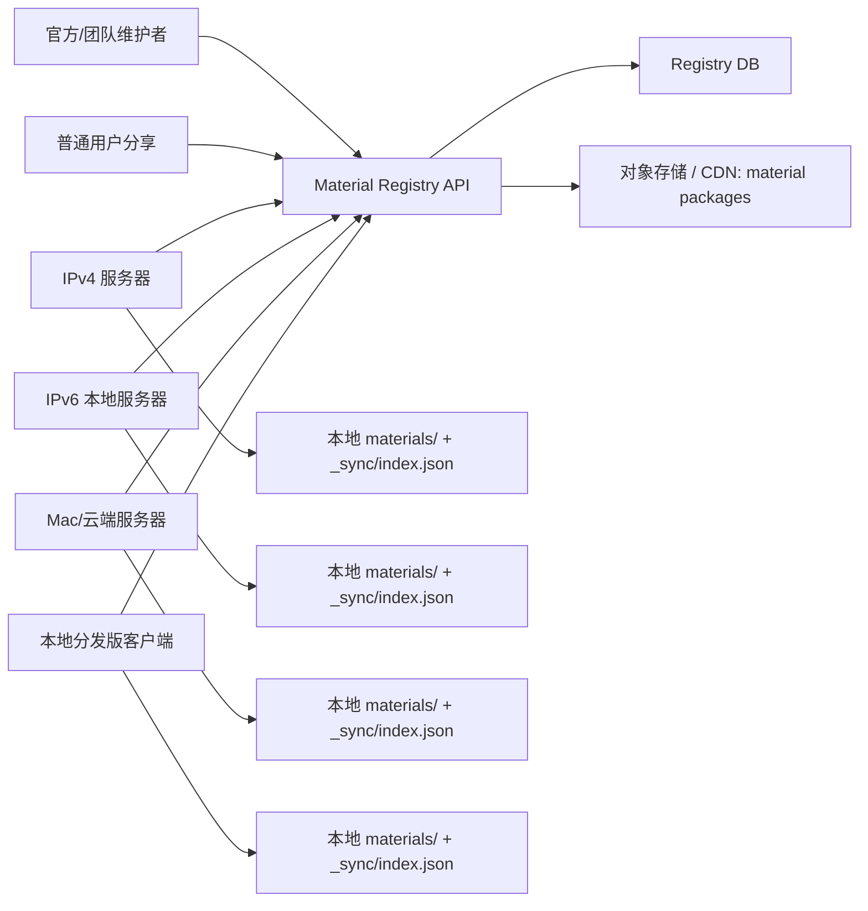

# 耗材 Registry 云同步与分享设计

状态：设计评审稿  
日期：2026-06-08  
建议审阅人：@Cat-By-Cat @Lanzyu369 @Neroued @sandboxdream

## 背景

当前 Lumina Studio 已经出现三个并行部署目标：IPv4 服务器、IPv6 本地服务器，以及后续计划迁移到 Mac 或其他本地/云端节点。耗材库现在仍以本地 `materials/` 文件夹为主，每台机器都可以拥有不同的耗材档案、导入历史和可重建缓存。短期内这能快速上线，但长期会产生几个问题：

- 多台服务器的耗材数据容易漂移，用户在不同入口看到的可用耗材不一致。
- 后续分发本地版本时，新用户需要从云上获取官方/团队耗材，而不是手工拷贝某台服务器的目录。
- 团队成员和用户需要方便分享耗材档案，同时不能覆盖别人本地已验证的耗材。
- `_solver_cache` 等大缓存可以重建，不适合在机器之间无差别同步。

本设计的结论是：建立一个云端 Material Registry 作为耗材元数据和包版本的事实源，耗材文件以可校验的 ZIP package 存在对象存储中；服务器和本地客户端都只做“拉取、校验、安装、缓存”，不再把任意一台服务器的磁盘目录当作长期主库。

## 目标

- 三台线上/本地服务器能够从同一个耗材源同步，保持官方和团队耗材版本一致。
- 本地分发版可以按频道下载官方、团队或用户订阅的耗材，并支持离线使用。
- 用户可以继续使用现有 ZIP 导入/导出，也可以上传到云端生成分享链接。
- 同步必须保护本地用户数据：不静默覆盖用户自己创建或修改的耗材。
- 同步内容必须可校验、可回滚、可增量更新，并能在网络失败时保留上次可用版本。
- 设计要兼容现有 `materials/<brand>/<material>/material.json` 和 `stage_A_parameters.json` 档案结构。

## 非目标

- 不在第一阶段实现实时协同编辑或多人同时修改同一个耗材。
- 不同步 `_solver_cache`、preview cache、临时输出、日志等可重建或机器本地内容。
- 不把 `usage_stats.json` 作为云端统计源；它默认仍是本机使用计数。
- 不要求立刻废弃现有 ZIP 导入/导出接口。
- 不把所有用户私有耗材自动上传到云端；上传必须是显式动作。

## 当前系统事实

现有耗材档案主要由这些文件组成：

- `materials/<brand>/<material>/material.json`
- `materials/<brand>/<material>/stage_A_parameters.json`
- 可选边车文件 `usage_stats.json`
- 可重建缓存目录 `materials/_solver_cache/`

现有 API 已支持耗材 ZIP 导入/导出：

- `POST /api/extractor/gradient-card-materials/export`
- `POST /api/extractor/gradient-card-materials/import`
- `GET /api/extractor/gradient-card-materials`
- 删除和更新接口基于 `directory_name` 操作本地目录。

当前导出 ZIP 的 manifest 是 `schema_version=1.0`、`kind=lumina_material_export`，主要记录目录名和数量。导入时如果目标目录已存在，会追加时间戳后缀，避免直接覆盖。

反馈工单打包已明确排除 `_solver_cache/`，因为该缓存可本地重建，打包会显著膨胀体积。这条规则应延续到云同步。

## 推荐方案

采用“云端 Registry + 对象存储 package + 本地同步索引”的三层模型。



Registry API 负责回答“有哪些耗材、最新版本是什么、用户能否访问、package 在哪里、hash 和签名是什么”。对象存储只负责保存不可变 ZIP 包。每台服务器和本地客户端维护自己的 `materials/` 安装目录和 `_sync/index.json` 同步索引。

不推荐把三台服务器之间直接做 rsync 作为长期方案。rsync 可以作为一次性迁移工具，但它会把缓存、临时文件、机器本地状态和误删同步出去，也无法表达版本、审核、权限和分享链接。

## 核心概念

### Material

Material 是一个逻辑耗材身份。它不等于本地目录名，也不等于显示名称。一个 Material 有稳定 `material_id`，例如 `mat_01JZ...`。

### Revision

Revision 是一次不可变发布。每次内容变化都会生成新的 `revision_id` 和 `content_hash`。相同 `material_id` 可以有多个 revision。

### Channel

Channel 表示分发范围：

- `official`：官方内置或团队确认的稳定耗材。
- `team`：团队内部共享，供服务器和成员使用。
- `community`：用户公开分享，可能需要审核或标记可信度。
- `private`：用户私有，只对本人账号可见。
- `unlisted`：有链接可访问，但不出现在公开目录。

### Package

Package 是可下载、可校验的 ZIP 文件。它至少包含：

- `material.json`
- `stage_A_parameters.json`
- `manifest.json`
- 可选缩略图或预览图

Package 不应包含：

- `_solver_cache/`
- preview cache
- 生成输出文件
- 日志
- 默认情况下的 `usage_stats.json`

### Local Sync Index

`_sync/index.json` 是本地安装状态表，用来记录某个 `material_id` 当前安装在哪里、安装的是哪个 revision、hash 是否匹配、来自哪个 channel。它避免继续把目录名当作唯一身份。

## 身份字段与安装状态边界

Registry 里有四个容易混淆的字段：`material_id`、`revision_id`、`content_hash`、`local_directory`。它们不能互相替代，必须分工使用。

### `material_id`：逻辑耗材身份

`material_id` 表示“这是哪一个耗材”。它用于维护同一个耗材跨 revision 的谱系，例如更新、回滚、审核、下架、分享链接、权限和统计。它不应依赖本地目录名，也不应因为用户把目录改名就变化。

`material_id` 适合回答：

- 这个云端耗材的最新版本是什么。
- 当前 revision 是否替换或继承自同一个耗材的旧 revision。
- 谁有权限发布、审批或下架这个耗材。
- 本地 `_sync/index.json` 中某个已安装包属于哪条云端谱系。

`material_id` 不适合单独回答“本机是否已经有这份耗材内容”。历史 ZIP、手动导入、旧版本本地档案、跨服务器导出再导入，都可能产生相同内容但不同 `material_id` 的情况。如果只按 `material_id` 判定安装状态，云端耗材库会把这些已有耗材误判为未安装。

### `revision_id`：一次不可变内容版本

`revision_id` 表示某个 `material_id` 下的一次发布版本。只要可校验内容发生变化，就应该产生新的 `revision_id`。回滚 UI、更新提示和历史版本列表都应以 `revision_id` 为单位。

`revision_id` 适合回答：

- 本地当前安装的是哪个版本。
- 云端是否提供更高或不同的版本。
- 用户要回滚到哪个历史版本。
- 这个 package 是否已经作为某个历史 revision 被记录。

`revision_id` 不应承担本地路径定位。一个 revision 可以在不同机器安装到不同目录；同一目录也可能因为用户导入冲突而被加时间戳后缀。

### `content_hash`：可校验内容指纹

`content_hash` 表示 package 中核心耗材内容的指纹。当前 v2 语义只把必须参与同步的内容纳入 hash，例如 `material.json` 和 `stage_A_parameters.json`；不纳入 `_solver_cache/`、preview cache、日志、输出文件和默认本地 `usage_stats.json`。

`content_hash` 适合回答：

- 本地内容和云端 revision 的核心内容是否一致。
- 两个不同来源的耗材是否实际上是同一份内容。
- package 下载后是否被篡改或损坏。
- 本地已有耗材是否可以显示为“已安装”，即使 `material_id` 不同。

`content_hash` 不适合单独表示耗材身份。两个目录可以故意保存相同内容；同一耗材修正文案、参数或校准数据后也会生成新 hash。

### `local_directory`：本机安装位置

`local_directory` 表示当前机器上耗材安装在 `materials/` 下的相对路径，例如 `BrandA/pla-basic`。它是本地文件定位和 UI 展示的重要字段，但不是云端身份。

`local_directory` 适合回答：

- 本机要从哪里读取 `material.json` 和 `stage_A_parameters.json`。
- 用户看到的本地库路径是什么。
- 导入冲突时新目录应该如何命名。
- 安装状态匹配时，哪一个本地目录与云端条目对应。

`local_directory` 不能作为全局唯一 ID。用户可以改目录名，不同机器也可能因品牌命名、语言、导入冲突后缀而不同。

### 安装状态判定优先级

云端耗材库判断“已安装 / 可更新 / 未安装”时，应使用组合规则，而不是单字段规则：

1. 优先用 `local_directory + content_hash` 判断“本机这个目录下已经有同一份核心内容”。命中时显示为已安装，即使 `material_id` 或 `revision_id` 不同。这解决历史导入和多服务器迁移导致的 ID 漂移。
2. 如果没有本地签名命中，再用 `_sync/index.json` 中的 `material_id` 判断同一云端谱系是否安装过。
3. 在同一 `material_id` 命中后，用 `revision_id` 判断是否是当前版本、可回滚历史版本，还是云端提供了可更新版本。
4. `content_hash` 不一致时，不应静默覆盖本地内容；需要显示更新、安装副本或用户确认。

因此推荐模型是：`material_id` 管“身份和谱系”，`revision_id` 管“版本”，`content_hash` 管“内容一致性”，`local_directory` 管“本机位置”。当前本地安装状态应优先按 `local_directory + content_hash` 精确匹配，再回退到 `material_id` 谱系匹配。

## Material Package v2

建议新增单耗材 package manifest，兼容现有 ZIP 外壳，但把身份、版本和校验信息补齐。

```json
{
  "kind": "lumina_material_package",
  "schema_version": "2.0",
  "material_id": "mat_01JZABCDE1234567890",
  "revision_id": "rev_01JZABCDE1234567890",
  "parent_revision_id": "rev_01JY...",
  "content_hash": "sha256:...",
  "channel": "team",
  "visibility": "team",
  "display": {
    "brand": "Polymaker",
    "material_name": "Panchroma PLA 蓝色",
    "material_type": "PLA",
    "color_name": "蓝色"
  },
  "files": [
    {
      "path": "material.json",
      "role": "material_archive",
      "sha256": "...",
      "bytes": 12345,
      "required": true
    },
    {
      "path": "stage_A_parameters.json",
      "role": "stage_a_parameters",
      "sha256": "...",
      "bytes": 23456,
      "required": true
    }
  ],
  "compatibility": {
    "min_app_version": "0.0.0",
    "material_schema_version": "1"
  },
  "created_at": "2026-06-08T00:00:00Z",
  "created_by": "github:Cat-By-Cat",
  "signature": {
    "algorithm": "ed25519",
    "key_id": "lumina-materials-2026",
    "value": "base64..."
  }
}
```

现有多耗材导出 ZIP 可以升级为 bundle manifest：

- `kind=lumina_material_bundle`
- `schema_version=2.0`
- `packages=[...]`

导入器应同时接受 v1 `lumina_material_export` 和 v2 package/bundle。v1 导入保持现有行为；v2 导入优先使用 `material_id` 和 `revision_id` 做冲突判断。

## 云端 Registry 数据模型

### materials 表

- `material_id`
- `owner_type`：official、team、user
- `owner_id`
- `default_channel`
- `canonical_brand`
- `canonical_name`
- `created_at`
- `updated_at`
- `deleted_at` 或 `deprecated_at`

### material_revisions 表

- `revision_id`
- `material_id`
- `content_hash`
- `package_url`
- `package_bytes`
- `package_sha256`
- `manifest_json`
- `created_by`
- `created_at`
- `review_status`：draft、pending_review、approved、rejected、deprecated
- `supersedes_revision_id`

### material_channels 表

- `channel`
- `material_id`
- `revision_id`
- `visibility`
- `published_at`
- `sort_key`
- `quality_flags`

### share_links 表

- `share_id`
- `material_id`
- `revision_id`
- `created_by`
- `visibility`
- `expires_at`
- `max_downloads`
- `created_at`

### audit_events 表

- `event_id`
- `actor_id`
- `action`
- `material_id`
- `revision_id`
- `metadata`
- `created_at`

## Registry API 草案

这些是云端 API，不要求复用当前本地 `/api/extractor/...` 路由命名。

- `GET /v1/materials/catalog?channel=team&since=<cursor>`  
  返回可见耗材摘要、最新 revision、hash、大小、更新时间和分页 cursor。

- `GET /v1/materials/{material_id}`  
  返回耗材详情、可见 revision 列表、审核状态和兼容性信息。

- `GET /v1/materials/{material_id}/revisions/{revision_id}/download`  
  返回短期有效的对象存储下载 URL、package hash 和签名。

- `POST /v1/materials`  
  创建新 material，并上传初始 revision。可拆成“申请上传 URL + 完成发布”两步。

- `POST /v1/materials/{material_id}/revisions`  
  发布新 revision。

- `POST /v1/materials/{material_id}/share-links`  
  生成私有或 unlisted 分享链接。

- `POST /v1/reviews/{revision_id}`  
  团队审核通过、拒绝或要求修改。

本地应用仍保留现有导入/导出 API。后续可以在本地 API 增加：

- `GET /api/material-sync/status`
- `POST /api/material-sync/refresh`
- `POST /api/material-sync/install`
- `POST /api/material-sync/upload`

## 对象存储布局

对象存储应使用不可变路径，避免同名覆盖：

```text
materials/
  mat_01JZABCDE1234567890/
    rev_01JZABCDE1234567890/
      material-package.zip
      manifest.json
      thumbnail.webp
```

上传流程：

1. 客户端或服务器生成 package。
2. 计算 manifest 中每个文件 hash 和 package hash。
3. 上传到临时对象路径。
4. Registry 校验 hash、大小、manifest 和权限。
5. 校验通过后发布 revision，临时对象变为不可变正式路径。

下载流程：

1. 同步器读取 catalog。
2. 对比 `_sync/index.json` 中的 `revision_id` 和 `content_hash`。
3. 只下载缺失或版本落后的 package。
4. 下载到 staging 目录。
5. 校验 package hash、manifest hash、签名和 ZIP 安全性。
6. 解压到 staging material 目录。
7. 原子切换到正式安装目录并更新 `_sync/index.json`。

## 本地安装布局

本地仍以 `materials/` 为安装根，但逻辑身份不再依赖目录名。

推荐长期布局：

```text
materials/
  _synced/
    official/
      mat_01JZABCDE1234567890/
    team/
      mat_01JZABCDE9999999999/
  _sync/
    index.json
  <用户本地品牌>/
    <用户本地耗材>/
```

如果短期 UI 仍假设路径就是品牌/耗材名，可以先采用兼容布局：

```text
materials/
  <brand>/
    <material_name>/
      material.json
      stage_A_parameters.json
  _sync/
    index.json
```

兼容布局必须遵守两条规则：

- 如果目标目录已有用户本地耗材，不能覆盖；应安装到带后缀的新目录，并在 `_sync/index.json` 记录真实目录。
- UI 展示应优先使用 `material.json` 中的品牌和名称，而不是依赖目录路径。

## `_sync/index.json` 草案

```json
{
  "schema_version": "1.0",
  "last_sync_at": "2026-06-08T00:00:00Z",
  "registries": {
    "default": {
      "base_url": "https://materials.luminastudio.com.cn",
      "last_cursor": "cursor..."
    }
  },
  "installed": {
    "mat_01JZABCDE1234567890": {
      "revision_id": "rev_01JZABCDE1234567890",
      "content_hash": "sha256:...",
      "channel": "team",
      "source": "registry",
      "registry": "default",
      "local_directory": "_synced/team/mat_01JZABCDE1234567890",
      "display_brand": "Polymaker",
      "display_name": "Panchroma PLA 蓝色",
      "installed_at": "2026-06-08T00:00:00Z",
      "updated_at": "2026-06-08T00:00:00Z"
    }
  },
  "local_overrides": {
    "mat_01JZABCDE1234567890": {
      "status": "modified_locally",
      "local_directory": "Polymaker/Panchroma PLA 蓝色 - 本地修改"
    }
  }
}
```

索引文件只描述同步状态，不替代 `material.json`。如果索引损坏，系统应能通过扫描 `material.json` 继续工作，只是失去云端版本判断能力。

## 三服务器同步策略

三台服务器都应作为 Registry 的客户端，而不是互相同步文件。

建议策略：

- 启动时执行一次轻量 catalog refresh。
- 后台每 5 到 30 分钟按 channel 拉取增量更新。
- 管理员可手动触发“立即同步”。
- 每个服务器有独立的本地 cache 和 `_sync/index.json`。
- 下载失败、校验失败或 Registry 不可用时，继续使用上次安装成功的耗材。
- 同一台机器上的同步任务需要单机锁，避免两个任务同时安装同一个 material。

服务器部署频道建议：

- 生产服务器默认订阅 `official` 和 `team`。
- 测试服务器可额外订阅 `community_pending` 或 staging channel。
- 用户本地版本默认订阅 `official`，登录后可订阅 team/private/community。

## 本地分发版同步策略

本地版本应是 offline-first：

1. 首次启动时内置一个最小官方耗材集合，保证无网可用。
2. 用户登录或允许联网后，拉取 catalog。
3. UI 显示可下载、已安装、可更新、已过期、冲突状态。
4. 下载和安装可暂停/重试。
5. 用户本地创建的耗材永远保留在本地，除非用户明确删除或上传。

本地客户端不应默认上传耗材，也不应上传 `usage_stats.json`。如果未来需要匿名统计，应设计单独的遥测开关和隐私说明。

## 用户分享流程

### 继续支持 ZIP 分享

现有 ZIP 导出是最小可用分享方式，应继续保留。升级后：

- 导出 v2 manifest。
- 导入时校验 hash 和 ZIP 安全性。
- 如果 ZIP 缺少 v2 manifest，按现有 v1 兼容逻辑导入。

### 云端分享链接

用户选择一个本地耗材后，可执行“上传并分享”：

1. 本地打包 package，排除 `_solver_cache` 和默认排除 `usage_stats.json`。
2. 用户选择 private、unlisted 或提交 community。
3. 上传 package 到 Registry。
4. Registry 返回 share link 或审核状态。
5. 接收方打开链接后可以预览 manifest 和关键字段，再决定安装。

### 官方/团队审核

进入 `official` 或 `team` channel 的耗材必须经过审核：

- manifest 完整。
- 基础字段可读。
- Stage A 参数能被当前版本解析。
- 颜色、品牌、耗材类型、来源说明符合团队规范。
- 可选：跑一组快速 solver/cache 构建 smoke。

审核通过后发布 immutable revision。后续修改必须发新 revision，不改旧 package。

## 冲突与版本规则

- `material_id + revision_id` 已安装且 hash 相同：跳过。
- `material_id` 相同但 revision 更新：下载新 revision，校验通过后切换。
- `material_id` 相同但本地被修改：保留本地副本，新增云端 revision 或提示用户选择。
- 显示名称相同但 `material_id` 不同：允许共存，UI 应显示来源或后缀。
- 云端删除：Registry 发布 tombstone/deprecated 状态，本地不自动物理删除，只提示“已下架”。
- 审核拒绝：revision 不进入官方/team channel，但创建者仍可在 private/unlisted 中看到。

所有发布的 revision 都应不可变。需要修正时创建新 revision，并记录 `supersedes_revision_id`。

## 安全与隐私

同步和导入必须保持现有 ZIP 安全规则：

- 拒绝绝对路径。
- 拒绝 `..` 路径逃逸。
- 限制单包大小、文件数量和解压后总大小。
- 校验每个文件 hash 和 package hash。
- 对官方/team channel 使用签名校验。
- 不导入未知可执行文件。
- 上传前默认去掉本地绝对路径、用户机器信息、日志、缓存和 `usage_stats.json`。

权限模型：

- anonymous：只能读取 public official/community approved。
- logged-in user：读取自己的 private/unlisted，上传 private/unlisted，提交 community 审核。
- team member：读取 team，提交 team 审核。
- maintainer：发布 official/team，处理 deprecated/tombstone。

## 可靠性与可观测性

同步任务应具备：

- 单机互斥锁，避免并发安装同一个耗材。
- staging 目录安装，校验通过后原子切换。
- 断点重试或整包重试。
- 下载超时和最大重试次数。
- catalog cursor，支持增量同步。
- 本地 index 损坏时可重建。
- 结构化日志事件，例如 `material_sync_catalog_done`、`material_sync_package_installed`、`material_sync_package_failed`。

失败处理原则：

- Registry 不可用：继续使用本地已安装耗材。
- 单个 package 校验失败：跳过该 package，记录错误，不影响其他耗材。
- 本地冲突：不覆盖用户文件，转为需要人工处理的状态。

## 与现有代码的兼容路径

第一阶段应尽量复用现有导入/导出能力：

- `export_saved_stage_a_material_archives()` 增加 v2 manifest 输出能力。
- `import_saved_stage_a_material_archives()` 同时接受 v1 和 v2 manifest。
- 当前 `directory_name` 仍保留给本地 UI/API 使用。
- 新增同步层只负责下载、校验、调用导入/安装逻辑、更新 `_sync/index.json`。

这样可以先把“包格式、身份、冲突规则”稳定下来，再实现云端 Registry。

## 分阶段落地

### 阶段 1：Package v2 与本地同步索引

- 定义 v2 manifest schema。
- 导出 ZIP 时写入 v2 manifest。
- 导入器兼容 v1/v2。
- 新增 `_sync/index.json` 读写。
- 明确排除 `_solver_cache`、preview cache、临时输出、默认排除 `usage_stats.json`。
- 增加冲突处理测试。

这一阶段不依赖云端，可以先在本地和三台服务器上验证。

### 阶段 2：Registry Catalog 与对象存储

- 实现最小 Registry API。
- 接入对象存储和不可变 package 路径。
- 支持 official/team channel。
- 支持 catalog 增量拉取和 package 下载校验。
- 管理员可以上传并发布 team 耗材。

### 阶段 3：服务器自动同步

- 三台服务器配置相同 Registry 地址和 channel。
- 启动时和定时任务同步。
- 管理员可手动刷新。
- 结构化日志和健康检查能看到同步状态。
- 同步失败不影响现有转换流程。

### 阶段 4：本地客户端下载与用户分享

- 本地 UI 显示云端耗材目录。
- 支持一键下载、更新、删除本地安装。
- 支持上传分享链接。
- 支持 community 提交和审核流。

## 测试与验收

### 单元测试

- v2 manifest schema 校验。
- v1 ZIP 仍可导入。
- v2 package hash 不匹配时拒绝导入。
- ZIP 路径逃逸被拒绝。
- `_solver_cache`、preview cache、临时输出不进入 package。
- `usage_stats.json` 默认不进入 package。
- `material_id` 相同、revision 不同的升级路径。
- 本地冲突不覆盖用户目录。

### 集成测试

- 模拟 Registry catalog 返回两个 revision，本地只下载缺失 revision。
- 模拟下载失败，已安装耗材继续可用。
- 模拟三台服务器从同一 catalog 同步后得到相同 `material_id/revision_id/content_hash`。
- 模拟旧 ZIP 分享文件导入，行为与当前版本一致。
- 模拟用户上传 private package 后生成 share link。

### 人工验收

- 在一台服务器上传 team 耗材后，另外两台服务器无需手动拷贝即可同步到相同 revision。
- 本地已有同名耗材时，同步不会覆盖用户文件。
- 断网后应用仍能看到之前安装成功的耗材。
- 清空 `_solver_cache` 后，系统可以按现有逻辑重新构建缓存。
- 用户导出的 ZIP 可以被另一台机器导入，且 manifest 能显示来源和版本。

## 风险与取舍

- 引入 `material_id/revision_id` 会增加一次数据迁移，但这是解决同名冲突和多端同步的必要前提。
- `_synced/` 长期布局更干净，但可能需要 UI 列表逻辑适配；兼容布局改动小，但目录名冲突处理更复杂。
- 签名校验会增加发布链路复杂度，但对官方/team channel 值得做。
- Registry API 需要账号和权限体系；MVP 可先只做 team/official 内部发布，community 分享延后。
- 云同步不应替代本地备份。用户私有耗材仍应支持 ZIP 导出。

## 待团队确认的问题

- 第一阶段是否采用 `_synced/<channel>/<material_id>/` 作为长期安装目录，还是先沿用 `<brand>/<material>` 兼容布局。
- 官方/team channel 的审核负责人和发布权限如何划分。
- 对象存储选择国内 OSS/COS 还是海外 S3/R2，是否需要 CDN 加速。
- 本地分发版是否要求登录后同步 private/team，还是只提供 public official。
- 是否需要为 community 耗材设计评分、举报和下架机制。

## 推荐结论

建议先做阶段 1：Package v2 + `_sync/index.json` + 兼容现有 ZIP 导入/导出。它不会改变现有服务器部署方式，也不会强依赖云服务，但能先把“耗材身份、版本、冲突、不覆盖用户数据、排除缓存”这些基础规则定下来。

阶段 1 稳定后再做 Registry Catalog 和三服务器同步。这样团队可以先评审数据模型和迁移风险，再决定云厂商、权限和 UI 细节。
