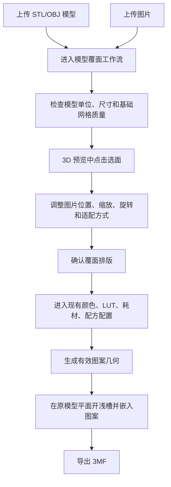

# 模型覆面功能设计说明

## 先说结论

这次要做的是 **上传一个平面类 STL/OBJ 模型，再上传一张图片，把图片生成的多材料图案嵌入到模型选定平面里，最后导出 3MF**。

第一版只做平面覆面，不做曲面包覆。用户能看到的核心体验是：

1. 上传模型和图片后，Lumina 进入“模型覆面”工作流。
2. 用户在 3D 预览里点击一个平面，调整图片在该平面上的位置、缩放和旋转。
3. 用户确认排版后，再复用现有图片转多材料模型流程，选择颜色数、LUT、耗材和配方。
4. 后端在原模型表面向内部开浅槽，把多材料图案嵌进去，外表面与原模型表面齐平。
5. 导出的 3MF 保持原模型外形、尺寸和厚度不变，孔洞和倒角不被覆面填死。

这不是把一张图片简单贴成纹理，也不是在模型表面堆一个凸起贴片。目标是产生可切片、可打印、带真实多材料几何的模型。

## 范围

第一版支持：

- 输入模型：`STL` 和 `OBJ`，按单色几何处理。
- 输入图片：沿用现有图片上传、颜色量化、LUT、配方和 3MF 生成能力。
- 目标模型：以洞洞板、铭牌、板状零件等平面类模型为主。
- 覆面区域：用户点击的严格共面连通区域。
- 孔洞处理：默认贴边模式，同时提供退让参数。
- 图片排版：拖拽、缩放、旋转、居中、重置、铺满面、完整图片。
- 输出：3MF，原模型基板对象和图案多材料对象共同组成最终模型。

第一版不做：

- 曲面包覆。
- 多个面同时覆面。
- 3MF 模型导入和原始材料读取。
- 自动把复杂坏网格强修复到可布尔状态。
- 复制 BambuStudio、OrcaSlicer 或其他 AGPL 项目的代码。
- 把图片当纯纹理导出；输出必须是可打印几何。

## 用户流程

普通图片转模型流程保持不变。只有当同一会话里同时检测到模型文件和图片文件时，才进入模型覆面工作流。

流程如下：

关键顺序是：**先选面和排版，再做颜色与材料配置**。颜色量化和配方配置消费的是裁剪到模型面的有效图案区域，不是原始整图。

## 3D 选面和排版

前端在现有 3D 预览能力上增加模型覆面模式。

用户点击模型时，前端通过 raycast 拿到命中的三角面和法线。后端或共享几何逻辑以该三角面为种子，在真实 mesh 上扩展到同一平面、同一连通区域的三角面集合。

选面规则：

- 默认只选择鼠标点所在的真实共面连通区域。
- 倒角不参与覆面，因为倒角面法线或平面距离不同。
- 孔洞边缘不被填充，孔洞成为覆面区域里的内边界。
- 提供“扩展到同平面全部区域”按钮，用于用户明确希望覆盖多个断开的同平面区域。
- 背景点击、非平面点击、面积过小点击都给明确提示，不改变当前有效选择。

图片排版规则：

- 用户可以在 3D 画布上拖拽图片。
- 用户可以用控件精确调整 X/Y 偏移、缩放、旋转角度。
- “铺满面”让图片覆盖整个选中面，可能裁掉图片边缘。
- “完整图片”保留整张图片，可能在选中面内留空边。
- “居中”和“重置”提供快速恢复。
- 如果图片和选中面比例一致，自适应后应完整覆盖选中面。

透明图片按透明区域为空处理：透明像素不生成图案，也不挖槽。非透明白色仍然是普通颜色，由现有颜色和材料流程决定是否生成。

## 几何语义

覆面的几何结果必须满足三个约束：

1. 原模型外部包围盒不变。
2. 原模型整体厚度不变。
3. 图案最外表面与被选平面齐平。

实现语义是：在选中平面沿模型内部方向挖一个浅槽，槽深默认等于最终图案总厚度；再把多材料图案嵌入该浅槽。用户看到的是彩色图案成为模型表面的一部分，而不是贴在模型上方。

嵌入深度：

- 默认值等于现有图案模型的总厚度，例如颜色层数乘以层高。
- 如果现有流程有底板或额外辅助层，覆面流程只把可见图案层作为嵌入对象，避免额外改变模型厚度。
- 高级设置允许手动覆盖嵌入深度。
- 如果模型局部厚度小于嵌入深度，生成应停止并提示用户降低深度或换模型。

孔洞和倒角：

- 默认贴边模式：图案贴到孔洞和外轮廓的真实边界，适合用户想让图案完整进入孔边的洞洞板。
- 退让模式：对外轮廓和孔洞轮廓做 2D offset，图案离边界保留指定距离。
- 第一版默认退让值为 `0.2 mm`，用户可以调整。
- 倒角区域保留原模型几何，不被图案覆盖。

## 3MF 对象组织

导出的 3MF 应保持对象边界清晰：

- 原模型作为基板对象保留，使用用户选择的基板材料或默认材料。
- 图案作为多材料对象嵌入浅槽，继续使用现有材料槽、配方和命名规则。
- 3MF 中的对象可以是多个 mesh，但切片结果应体现为一个尺寸不变的模型。
- 不把所有材料强行合并成一个不可追踪对象，避免破坏现有材料映射和切片器模板逻辑。

这套组织方式既满足“相当于布尔结合”的打印语义，也保留 Lumina 现有 3MF 导出和材料身份追踪能力。

## 架构设计

### 前端

新增一个模型覆面工作流状态，放在现有 converter 会话体系下，而不是另起独立应用。

主要职责：

- 识别模型 + 图片同时存在时的覆面入口。
- 加载 STL/OBJ 到 3D 预览。
- 管理选面状态、图片排版变换和自适应操作。
- 在确认排版后，把有效覆面配置传给后端。
- 进入现有颜色、LUT、耗材和配方配置 UI。
- 在生成前显示模型质量、单位和布尔可用性的提示。

UI 文案必须进入 `frontend/src/i18n/translations.ts`。视觉风格遵循 `DESIGN.md`，控件采用现有按钮、滑杆、数字输入、图标按钮和状态提示，不做营销式页面。

### API

新增模型覆面相关 API，继续接入 `SessionStore` 和 `FileRegistry`。

API 边界负责：

- 校验上传文件类型。
- 保存模型、图片和覆面配置。
- 返回模型尺寸、单位推断、可选面分析结果和错误提示。
- 将确认后的覆面配置传入生成 worker。
- 把后端几何错误映射成稳定的 4xx/5xx 响应。
- 注册所有中间文件和最终下载文件，避免 session 切换后下载失效。

API 不直接做 CPU 重几何运算，重活放到 worker 或 `core/`。

### Core

新增一组 UI 无关的核心模块，建议放在 `core/model_surface/` 或相近命名下。

核心职责拆分如下：

- `ModelLoader`：用 `trimesh` 读取 STL/OBJ，做基础清理、尺寸统计和单位风险检查。
- `SurfaceSelector`：根据命中三角面找真实共面连通区域。
- `SurfaceFootprintBuilder`：把选中面投影到 2D 平面，生成外轮廓和孔洞轮廓。
- `PlacementMapper`：把图片排版变换映射到选中平面坐标系。
- `OverlayMaskBuilder`：根据贴边或退让规则，裁剪出有效图案区域。
- `PocketBooleanBuilder`：生成浅槽切割体，使用 `manifold3d` 做布尔差集。
- `SurfaceOverlayAssembler`：把基板和多材料图案组合成 3MF 可导出的 scene。

现有图片生成管线不应被复制。覆面流程应在“有效图案区域”准备好之后复用现有颜色量化、LUT、材料、配方和 3MF 写出能力。

## 依赖和协议边界

新功能允许使用这些依赖：

- `trimesh`：MIT，用于模型读取、基础清理、尺寸和 mesh 表达。
- `Shapely`：BSD-3-Clause，用于 2D 平面轮廓、孔洞、offset 和裁剪。
- `GEOS`：LGPL-2.1，作为 Shapely 底层动态依赖处理，保留 notice，不静态魔改。
- `manifold3d / Manifold`：Apache-2.0，用于 3D 布尔和可靠 manifold 几何。
- `Clipper2`：Boost Software License，可继续复用项目已有 native extension 做高性能 2D polygon 运算。
- `rasterio`：BSD 类宽松协议，只在复用现有栅格转轮廓路径时使用。

不引入为默认依赖：

- `PyMeshFix`：GPLv3。它不适合作为商业闭源授权路径里的默认依赖。
- BambuStudio / OrcaSlicer 代码：AGPLv3。它们只能作为交互和产品参考，不复制代码、资源、文案或结构化实现。

商业边界：

- 公开版可以采用 AGPL。
- 闭源平台客户应走 Lumina 自有代码的单独商业授权。
- 为保留双授权能力，新功能不能混入第三方 GPL/AGPL 代码。
- 所有第三方许可证和 notice 后续应集中进入第三方声明文档或打包产物。

## 模型质量和失败策略

第一版不做强制自动修复。原因是自动修复容易改变用户模型的孔洞、倒角和尺寸，也会引入额外依赖风险。

允许做的轻量处理：

- 合并重复点。
- 删除退化三角面。
- 统一法线方向。
- 移除孤立小片。
- 统计 watertight、非流形边、法线异常和尺寸异常。

失败时的用户提示：

- 模型不是封闭实体：提示用户在建模软件或切片器里修复后再试。
- 单位疑似错误：默认按 mm，但提供缩放修正入口。
- 选面不是有效平面：提示重新点击更大的平整区域。
- 布尔失败：提示模型几何不适合自动开槽，并保留用户配置以便重试。
- 嵌入深度超过模型厚度：提示降低图案厚度或换模型。

不提供“无开槽也导出”的默认降级，因为这会违背尺寸和厚度不变的核心需求。后续可以单独设计一个明确标注的实验模式。

## 测试策略

后端测试：

- STL/OBJ 上传类型校验。
- 单位异常和尺寸异常判断。
- 共面连通区域选择。
- 孔洞轮廓提取。
- 贴边和退让 offset。
- 透明图片区域不生成几何。
- 模型厚度小于嵌入深度时稳定失败。
- 布尔失败时返回确定错误，不泄露 traceback。
- 生成完成后关闭或切换 source session，最终 3MF 下载仍可用。

前端测试：

- 同时上传模型和图片后显示覆面工作流入口。
- 背景点击不改变当前选面。
- 选面后图片变换控件可用。
- 铺满面、完整图片、居中、重置更新状态正确。
- 确认排版后进入现有颜色和材料配置步骤。
- 错误状态和禁用状态使用翻译文本。

集成测试：

- 简单矩形板 + 图片。
- 带长圆孔洞洞板 + 图片。
- 带倒角孔洞洞板 + 图片。
- 退让参数变化。
- 单位疑似 inch 的模型。
- 非封闭或非流形模型。

人工验收：

- 导出的模型包围盒与输入模型一致。
- 图案表面与选中平面齐平。
- 孔洞没有被填死。
- 倒角仍保留原模型形状。
- 3MF 在 BambuStudio / OrcaSlicer 中打开后材料映射清晰。

## 分阶段实施

第一阶段：入口和状态

完成模型 + 图片检测、覆面工作流入口、模型上传校验和前端状态骨架。

第二阶段：选面和排版

完成 3D 点击选面、共面连通区域、图片拖拽缩放旋转、自适应按钮和配置保存。

第三阶段：2D footprint

完成选中面的 2D 投影、孔洞轮廓、贴边、退让和有效图片裁剪。

第四阶段：接现有图片管线

把裁剪后的有效图案区域送入现有颜色、LUT、耗材和配方流程，避免复制现有转换逻辑。

第五阶段：浅槽布尔和 3MF

用 `manifold3d` 生成基板浅槽，把图案嵌入，接入 3MF 导出和下载生命周期。

第六阶段：验证和打磨

补齐自动化测试、结构化日志、错误提示、切片器人工验收和许可证声明。

## 验收标准

这个功能完成时，至少要满足：

- 用户可以上传 STL/OBJ + 图片并进入覆面流程。
- 用户可以点击平面并调整图片排版。
- 洞洞板孔洞在生成后仍然存在。
- 倒角不被覆面覆盖。
- 图案嵌入后模型外尺寸和厚度不变。
- 导出的 3MF 能在常见切片器里打开并保留材料身份。
- 失败场景有可理解的错误提示。
- 默认依赖不包含 GPL/AGPL 组件。
- BambuStudio / OrcaSlicer 只作为参考，不进入代码来源。
